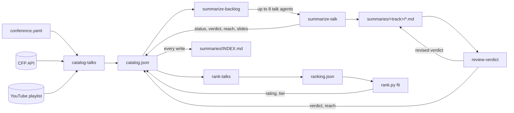

# Conference talk summaries

Written summaries of software-engineering conference talks, produced from the talk videos (captions, on-screen slides and, where the speaker published them, the slide deck). Currently covers **Devoxx Belgium 2026**.

Each summary tells you what the talk argued, what you'd take away, what was shown section by section (with links that jump to that moment in the video), which tools and specs came up, who should watch it, and an opinionated verdict with its audience reach. A separate ranking compares summarized talks and assigns watch-priority tiers.

## Finding talks

### Browse the index

Start at [`conferences/devoxx-be-2026/summaries/INDEX.md`](conferences/devoxx-be-2026/summaries/INDEX.md). It opens with must-watch and recommended talks across tracks, then lists every summarized talk by track. Within each list, talks sort by tier, ranking rating, then verdict; unranked talks follow the ranked ones.

| Column | Meaning |
|---|---|
| Tier | watch priority from the comparative ranking, see below |
| Verdict | 0–10, see the scale below |
| Reach | `niche`, `segment` or `broad`: how much of the conference audience can use the main content |
| Talk | links to the summary |
| When | day, local start time and room, handy for finding talks you attended or skipped |
| Type, Min, Level | session type, video length, audience level from the CFP |
| Favs | attendees who bookmarked the talk in the conference schedule. This measures interest *before* the talk, not quality. |
| Slides | the speaker's published deck, when one was found |

Summary files live in one folder per track: `summaries/<track>/<talkId>-<title>.md`.

### Tiers and reach

**Tier answers “should I watch this?”** It comes from comparing summarized talks by their worth to the audience described in [`conference.yaml`](conferences/devoxx-be-2026/conference.yaml), considering quality, reach and time investment.

| Tier | Share of ranked talks |
|---|---|
| `must-watch` | top 5% |
| `recommended` | next 15% |
| `if-relevant` | next 40% |
| `low-priority` | remaining 40% |

Quotas are rounded to whole talks. They apply to the ranked, summarized talks, not every session in the conference. The ranking is an agent judgment, not an attendee vote; it changes as talks are added or reassessed.

**Reach describes who can use the subject**, independent of quality: `niche` for a specialised area, `segment` for a sizable minority such as users of a common framework, `broad` for most of the conference audience. The horizon is applying the main content in their own work within the next year. Reach is never added to the verdict: a 10/10 niche talk can still rank below a lower-scoring talk useful to many more people.

For recommendations across subjects, use tier. Once you've chosen a subject, use verdict to compare its talks. Talks awaiting ranking or rescoring may have no tier or reach.

### Verdict scale

The verdict is the sum of five criteria, each scored 0–2 and each resting on something you can check: **novelty** (does watching give you more than searching the subject and reading the first few results?), **demonstrated** (claims shown working on screen), **measured** (numbers with a baseline or method), **depth** (internals and trade-offs) and **reusable** (a repository, configuration, checklist or code you can apply). A competent talk scores 1 on each, so the typical good talk lands at 5–6.

Each talk is judged against its own slot: a 20-minute beginner keynote isn't expected to go as deep or demo as much as a 3-hour deep dive, and a criterion that doesn't apply (no demo for a language proposal, no numbers for a talk that makes no quantitative claim) scores a neutral 1. Pacing, voice and stage presence are not scored: captions and video stills can't show them reliably.

| Score | Meaning |
|---|---|
| 9–10 | exceptional for its subject |
| 7–8 | strong for its subject |
| 5–6 | a typical good conference talk |
| 3–4 | thin, or the material is better elsewhere |
| 0–2 | skip |

Each summary's `## Verdict` section lists the five criteria with timestamp-linked evidence and a reach explanation. Each cited moment, source or artifact backs one criterion only, so the same evidence cannot inflate multiple scores. The verdict is the summarizing model's judgment of quality for the subject; it is not a conference-wide watch recommendation. The full rubric is in [`SUMMARY-FORMAT.md`](.agents/skills/summarize-talk/SUMMARY-FORMAT.md).

### Search from the command line

```sh
uv run scripts/catalog.py find devoxx-be-2026 --text "virtual threads" --text loom --max-minutes 60
uv run scripts/catalog.py find devoxx-be-2026 --tier must-watch --tier recommended --sort rating --limit 100
uv run scripts/catalog.py find devoxx-be-2026 --reach broad --sort rating
uv run scripts/catalog.py find devoxx-be-2026 --day mon --day tue --sort time
uv run scripts/catalog.py find devoxx-be-2026 --status summarized --min-verdict 7 --level beginner
uv run scripts/catalog.py find devoxx-be-2026 --min-depth 2 --min-demonstrated 1 --sort novelty
```

Each verdict criterion has its own filter, `--min-novelty`, `--min-demonstrated`, `--min-measured`, `--min-depth` and `--min-reusable` (0–2), and `--sort` accepts any criterion name.

The command returns JSON with each talk's TL;DR (or its abstract when not yet summarized), when it ran, length, verdict, criterion scores, reach, tier, rating and links. Tier and reach filters are repeatable (any listed value matches); different filters combine with AND. `--sort rating` uses tier, rating and verdict in that order. `--help` lists all filters. It needs only [`uv`](https://docs.astral.sh/uv/).

### Ask a coding agent

With a coding agent running in this repo, ask in plain language. The `find-talks` skill turns questions about topic, day, length, level, track, tier, verdict, reach or popularity into the search above, judges which results really fit, and also covers talks that aren't summarized yet:

- "Which talks under an hour cover Java concurrency or performance?"
- "Which talks should I watch first, across all tracks?"
- "Which recommended talks could most of my team use?"
- "Which talks did I possibly see on Monday morning?"
- "Most popular beginner talks on Tuesday?"

## Adding summaries

### How it works



The work is split into six agent skills in [`.agents/skills/`](.agents/skills/), backed by Python scripts in `scripts/` for fetching, matching, catalog bookkeeping and ranking calculations:

| Skill | Started by | What it does |
|---|---|---|
| `catalog-talks` | you | fetches the talks from the conference's CFP and matches each one to its YouTube video by fuzzy title match |
| `summarize-talk` | you or the agent | fetches the auto-captions, looks for the published deck (reading its PDF when available), grabs a few video frames for code and diagrams, and writes the summary in the format defined by [`SUMMARY-FORMAT.md`](.agents/skills/summarize-talk/SUMMARY-FORMAT.md) |
| `summarize-backlog` | you | runs `summarize-talk` over the next batch of unsummarized talks, with parallel sub-agents |
| `review-verdict` | you or the agent, only with a checker and a judge named | puts a summary's verdict through a three-way discussion and applies the outcome; `summarize-talk` runs it as its last step when given both; see [Reviewing verdicts](#reviewing-verdicts) |
| `rank-talks` | you | compares summarized talks in small groups, fits ratings from those comparisons, and assigns quota-based tiers; see [Ranking talks](#ranking-talks) |
| `find-talks` | you or the agent | searches the catalog and summaries |

Progress is tracked in the catalog, so any run can be stopped and restarted safely. [`AGENTS.md`](AGENTS.md) has the repo layout and glossary.

### Requirements

- a coding agent with skill support
- [`uv`](https://docs.astral.sh/uv/), which runs the Python scripts and installs their dependencies on first use
- [`yt-dlp`](https://github.com/yt-dlp/yt-dlp), for the video lists, captions and stream URLs
- `ffmpeg`, for video frames (`sudo apt install ffmpeg`). Without it, summaries are written from captions and slides only.

### Summarizing more talks of an existing conference

Run these skills, giving the conference slug:

1. **`catalog-talks devoxx-be-2026`** refreshes the catalog and picks up newly uploaded videos.
2. **`summarize-backlog devoxx-be-2026`** summarizes the next 10 talks. Add a number for another batch size, and `checker=… judge=…` to have every verdict reviewed (see [Reviewing verdicts](#reviewing-verdicts)).
3. To summarize, or re-summarize, one specific talk, just ask: "Summarize the Devoxx talk 'Maven 4'", adding a checker and a judge for a review.
4. To re-score only a specific summary's verdict and reach after a rubric change, ask to rescore that talk. `summarize-backlog devoxx-be-2026 10 rescore` handles the migration queue of summarized talks with **no reach yet**; it does not rescore every existing summary. Add `checker=… judge=…` for reviews. Summary content outside the verdict and its metadata stays unchanged.
5. To re-summarize talks in bulk (after changing the format or the summarizing model), put them back in the queue and run the backlog. Requeuing clears their verdict, reach, rating and tier, and removes them from `INDEX.md` until their new summary is recorded:

   ```sh
   uv run scripts/catalog.py find devoxx-be-2026 --status summarized | grep -o '"id": "[^"]*"' | cut -d'"' -f4 \
     | xargs -n1 uv run scripts/catalog.py set devoxx-be-2026 --status matched
   ```

`uv run scripts/catalog.py status devoxx-be-2026 --detail` shows progress. Each talk in the catalog has one status:

| Status | Meaning | What to do |
|---|---|---|
| `matched` | video found, waiting to be summarized | run the backlog |
| `summarized` | done | re-summarize by asking for that talk again |
| `needs-review` | a likely video was found, but the match wasn't confident | `catalog-talks` asks you to confirm it |
| `no-video` | no video in the playlist (yet) | re-run `catalog-talks` later, or add an override |
| `failed` | something broke (often YouTube throttling) | the backlog retries it, up to 3 attempts |
| `no-transcript` | the video has no captions | no summary is written |
| `excluded` | a session type that isn't recorded (BOFs, labs) | none |

To pin a talk to a video yourself, or to mark it as having none, add it under `overrides` in the conference file and re-run `catalog-talks`.

Commit the summaries together with `catalog.json`, `ranking.json` when present, and `INDEX.md`. Transcripts, frames, downloaded decks and review logs are local files and are gitignored.

### Reviewing verdicts

A verdict comes from the one model that wrote the summary. A review adds two more opinions in a short discussion:

1. A **checker** (fast and cheap) opens every verdict bullet's timestamp in the transcript and marks it supported, misread, moved or unsupported. It argues every score one level down, quoting the moment that undercuts it, and every unfair minus one level up (a short or beginner talk held to a deep dive's bar, cited sources counted as unoriginal, one shortfall counted twice). Then it sweeps the whole transcript for demos, numbers, repositories and internals the verdict left out.
2. The **author** concedes or contests each finding, quoting the transcript. A challenge stands unless the author can answer it.
3. A **judge** (the strongest model you have) settles every dispute against the transcript, scores the five criteria, and writes the verdict that replaces the old one. The summary gets a `reviewedAt` date.

Reviews are opt-in, because each one costs two extra agent runs. Name a checker and a judge, as your coding agent names sub-agents or models, and the review runs as the last step of summarizing, with the author still holding everything it read for the summary:

```
summarize-backlog devoxx-be-2026 checker=<fast agent or model> judge=<strong agent or model>
```

Under the backlog each summarizing sub-agent starts its own checker and judge, so your coding agent must let sub-agents start sub-agents. To review summaries that already exist, run the `review-verdict` skill, or ask in plain language ("review the verdict of talk 4098 with checker … and judge …"); a fresh agent then plays the author:

```
review-verdict devoxx-be-2026 4098 7006 checker=<fast agent or model> judge=<strong agent or model>
```

The discussion is kept in `conferences/<slug>/reviews/<id>.md`.

### Ranking talks

Run the ranking after summarizing, rescoring or reviewing talks:

```
rank-talks devoxx-be-2026
```

Optionally add `ranker=<agent or model>` to select the group judge. The skill resumes an interrupted ranking, or starts a new one when its state is stale. Add `restart` to discard the previous ranking explicitly. At least six summarized talks are required, and all must have reach; migrate older verdicts with the rescore backlog first.

The mechanism:

1. Start with random groups of about six talks. A ranker agent orders each group by worth to the conference audience, using only the generated briefs: title, speakers, format, track, length, level, TL;DR, who should watch, verdict headline and reach explanation.
2. Every earlier talk in a group counts as a win over every later one. A Bradley–Terry fit converts those pairwise outcomes into relative ratings.
3. Later rounds group neighbours by current rating, shifting group boundaries so talks meet new opponents. The default is `ceil(log2(number of talks)) + 2` rounds.
4. After the rounds, `rank.py fit` writes ratings and quota-based tiers through the catalog's locked writer and regenerates the index.

`ranking.json` stores groups and results under a file lock, so parallel judgments and interrupted runs can resume. Ratings are relative to this conference's ranked set, not another 0–10 score or a cross-conference comparison.

Read-only inspection:

```sh
uv run scripts/rank.py status devoxx-be-2026
uv run scripts/rank.py group devoxx-be-2026 1 0
uv run scripts/catalog.py find devoxx-be-2026 --tier must-watch --tier recommended --sort rating --limit 100
```

`status` reports unfinished groups and `stale` talk IDs: newly summarized or updated talks, or ranked talks no longer summarized. Existing catalog tiers are not automatically refreshed when a summary changes; rerun `rank-talks` to bring them up to date. The lower-level commands (`start`, `next`, `group`, `record`, `status`, `fit`) are documented by `uv run scripts/rank.py --help`; `start` replaces previous ranking state.

### Adding a new conference

1. **Create `conferences/<slug>/conference.yaml`.** Copy [the Devoxx Belgium one](conferences/devoxx-be-2026/conference.yaml) and change the fields:

   | Field | Meaning |
   |---|---|
   | `name`, `slug` | display name and directory name |
   | `audience` | who attends and what they work on; the reference for reach and comparative ranking |
   | `talks.source` | which talk-source adapter to use (see below) |
   | `talks.baseUrl` | the adapter's API root |
   | `videos.playlists` | YouTube playlist URL(s) holding this edition's recordings. Find one with `yt-dlp --flat-playlist --print '%(id)s %(title)s' https://www.youtube.com/@<channel>/playlists`. |
   | `videos.titleSuffix` | regex stripped from video titles before matching, e.g. a trailing `by <speaker>` |
   | `videos.captionLang` | caption track to fetch (`en-orig` is YouTube's original-language English) |
   | `matching.accept`, `matching.review` | similarity thresholds for `matched` and `needs-review` |
   | `excludeSessionTypes` | session types that aren't recorded |
   | `overrides` | `talkId: videoId` to force a match, `talkId: null` for no video |

2. **Check the talk source.**
   - **Devoxx and VoxxedDays events** use the same `cfp.dev` API: set `source: devoxx-cfp` and `baseUrl: https://<event>.cfp.dev/api/public`. Nothing else is needed.
   - **Any other CFP**: add an adapter function to `SOURCES` in [`scripts/catalog.py`](scripts/catalog.py). It takes the `talks` config and returns one dict per talk with the keys `id`, `title`, `speakers` (list of names), `track`, `sessionType`, `durationMin`, `audienceLevel`, `start` (ISO-8601 UTC), `timezone` (IANA name), `room`, `favourites`, `keywords` and `abstract`. Use `None` where the source has no data. Nothing else in the pipeline is conference-specific, so no skill needs editing.

3. **Build the catalog and summarize.** Run `catalog-talks <slug>`, then `summarize-backlog <slug> 3`. Check the first few summaries before running bigger batches. Once at least six talks are summarized with reach recorded, run `rank-talks <slug>`.

### Tips

- YouTube throttles heavy use (HTTP 429). The transcript fetch retries once; anything still failing is marked `failed` and retried on a later backlog run. The backlog fetches transcripts at most 3 at a time, then keeps up to 8 talk agents running as cached transcripts become available. Rescoring uses cached transcripts and needs no YouTube gate.
- `uv run scripts/<script>.py --help` documents every script. All catalog writes go through `catalog.py`'s locked writer, including ratings and tiers from `rank.py`; every write regenerates `INDEX.md`. Only `rank.py` writes `ranking.json`.
